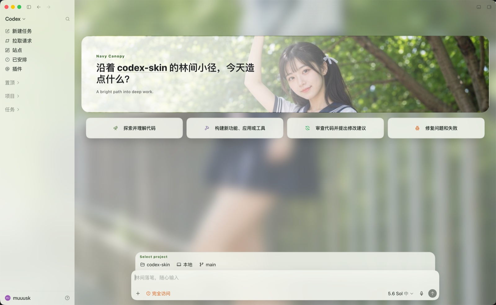
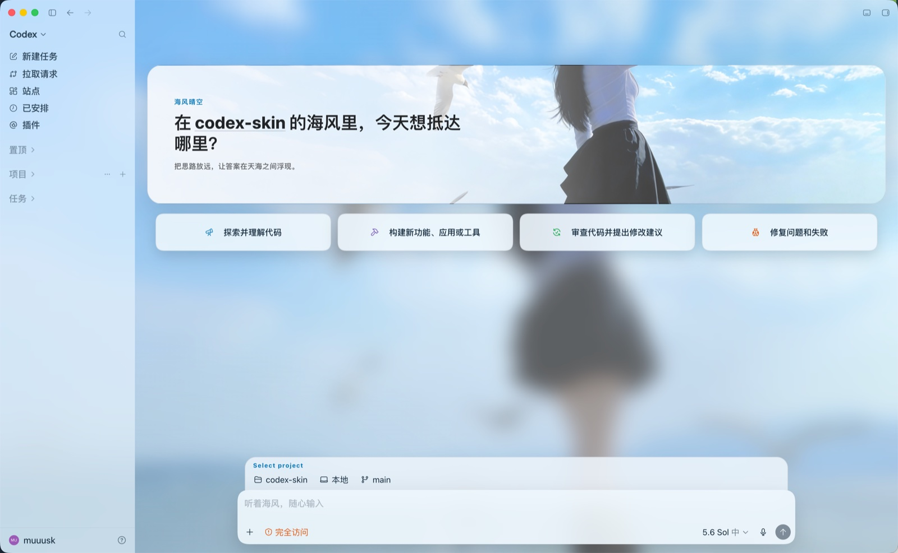
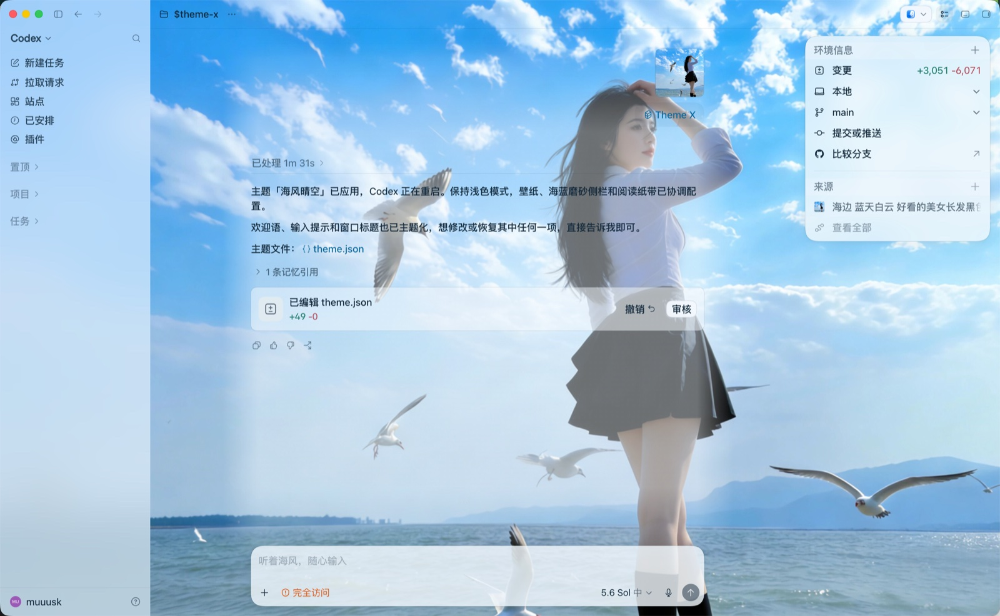
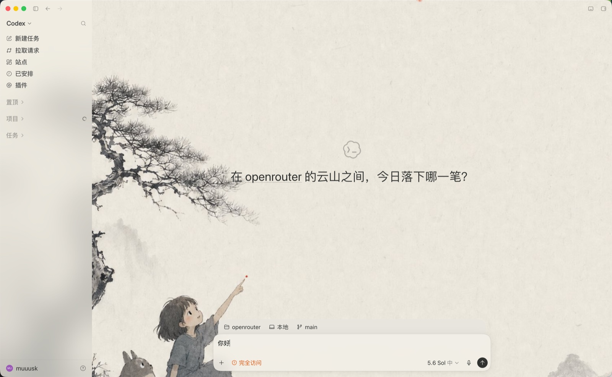
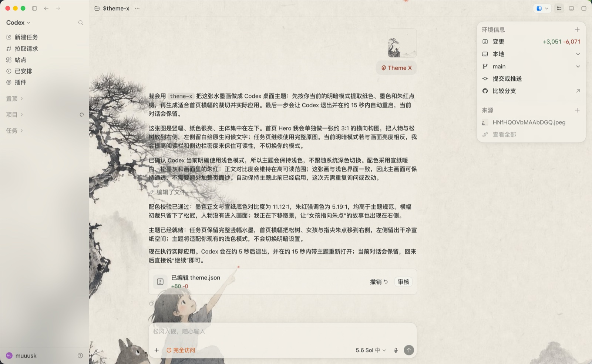
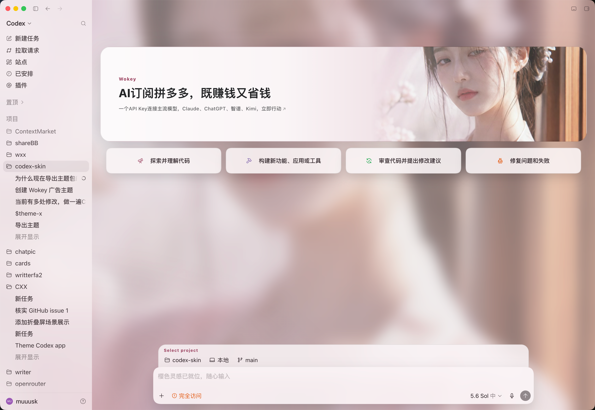

# codex-theme-x

**一个 Codex 桌面版的主题 skill：发一张图给 Codex，它自己把自己变成这个主题。**

普通主题之外，它也支持生成、导出和导入广告主题包；平台签发的广告包可按有效曝光记录收益归属。

[English](README.en.md) · [主题包格式](spec/codextheme-format.md) · [安装](#安装)



## 安装

让 Codex 自己装（零终端）——把这句话发给 Codex：

```
帮我安装 codex-theme-x：https://github.com/focuxdot/codex-theme-x
```

或者自己在终端里装，一行：

```
git clone --depth 1 https://github.com/focuxdot/codex-theme-x /tmp/codex-theme-x && bash /tmp/codex-theme-x/install.sh
```

装完开个**新对话**（skill 在对话开始时扫描），`$theme-x` + 一张图，完事：

```
$theme-x ~/Pictures/miku.jpg     # 一张图 → AI 配色 → 完整主题
$theme-x 赛博朋克雨夜             # 一句话 → 先生图再成主题
$theme-x 广告 ~/Pictures/ad.jpg  # 图片 + 广告文案/链接 → 广告主题
$theme-x list / switch / share（导出/分享）/ restore / doctor
$theme-x keep on                # 自动恢复背景，并启用事件驱动的上报桥接
```

换主题也是一句话。`$theme-x switch <主题名>`，全程不用重启——同一个应用，两种世界。

**海风晴空**——从空白页到任务页，一套配色贯穿到底：





**换一张水墨**，整个应用跟着换气质——画面全幅呈现，会话文字坐在一条柔边的
"阅读纸带"上，两侧画面不打折：





## 你得到的不只是壁纸

- **AI 看图配色**，写入 Codex **官方外观系统**（原生持久，官方更新不影响）
- **默认随明暗模式自动切换**：一张图生成亮/暗两套配色与磨砂，系统或 Codex 切模式时
  整套主题实时跟随，无需重新应用
- **空白页 Hero**：横向主题画卷 + 主题标语，任务页保持原生全幅画面
- **文案层**：问候语、输入框提示、窗口标题与画面同一个声音——截图里的
  「沿着…的林间小径」「听着海风，随心输入」「松风入砚」都来自主题本身；
  功能文字永不改动
- **毛玻璃分区**：侧栏磨砂、会话区全透，密度用嘴调（"侧栏再实一点"，即时生效）
- **一个文件分享**：`.codextheme` 包；没装本工具的人也能用包内的官方颜色串
- **广告主题完整链路**：生成可点击广告 Hero，导出/导入同一种主题包；平台包可携带收益归属
- **随时退出**：`$theme-x restore` 一句话回到官方原状

## 工作原理

1. **颜色、字体 → 官方外观系统。** 配色写入 `~/.codex/config.toml` 的官方
   `appearance*ChromeTheme` 表（写入前自动备份），重启后原生持久生效。
2. **背景图、Hero、毛玻璃、文案 → 可退化注入。** 通过仅绑定 127.0.0.1 的本机
   调试端口注入。软选择器失配时只退回原生页面，不影响任务页；`$theme-x doctor`
   一键自检。

不修改 `.app`、`app.asar`、不碰代码签名，完全可逆。

## 导出与导入主题包

```
$theme-x share            # 导出当前主题为 <id>.codextheme（一个 zip）
# share / export / 导出 / 分享 均可触发
```

普通主题和广告主题使用同一种 `.codextheme` 格式。把文件拖进 Codex 对话并说
“安装/应用这个主题”，theme-x 会解包、校验 `theme.json`、自动识别 `standard` 或
`sponsored`，再按对应类型应用，不需要单独的广告导入命令。

主题包包含 `theme.json`、背景/Hero 素材和 `official.txt`；平台签发的广告包还可包含
`adsmarket-distribution.json`。重新导出这类主题时，收益归属文件会一并保留。

没有安装 theme-x 的接收者仍可把 `official.txt` 中的 `codex-theme-v1:` 一行粘进
Settings → Appearance → Import，但这只导入官方配色，不包含背景、广告链接、统计或收益归属。

## 广告主题：制作、分发与收益



主题分两类，由 `type` 字段区分：`standard`（默认，普通主题）和 `sponsored`
（广告主题）。广告主题在普通主题之上，把空白页 Hero 卡的三行文案变成**可点击、
跳转到广告主链接**的槽位——点击唤起系统浏览器，可选「Sponsored」披露角标。

### 1. 生成广告主题

只有明确说出「广告 / 赞助 / sponsored」或使用 `sponsor` 指令，才会进入广告流程；普通图片
永远生成普通主题。任何人都可以制作广告主题，例如：

```
$theme-x sponsor ~/Pictures/product.jpg，品牌是 ACME，落地页 https://acme.example
$theme-x 用这张图做广告主题，主标题改成「一个 API 接入所有模型」
```

广告 Hero 有 `kicker`、`greeting`、`tagline` 三个独立槽位。每个槽位需要文案，链接可选且
只接受 `http/https`；至少一个槽位有效，广告主题才可加载。theme-x 会优先从当前项目上下文
读取品牌、文案和真实域名，并在完成时说明来源；没有可靠信息时不会编造域名。

链接只在用户明确点击对应槽位时打开系统浏览器：不会自动跳转、不会悬停跳转，整个 Hero
也不会变成隐形热区。`Sponsored` 披露角标默认关闭，仅在广告主或平台明确要求时加入。

### 2. 导出、转发和导入

生成或正在使用广告主题后，直接说 `$theme-x share` / `导出` 即可得到 `.codextheme`。
接收者把该文件拖进对话说“安装这个主题”即可使用；包内 `type: "sponsored"` 是类型权威，
导入时自动恢复广告文案、链接和主题外观。

如果广告包由平台为登录用户签发，它会额外携带公开的 `beneficiaryUserId`、主题 ID 和上报地址。
这不是登录凭证；它只指定有效曝光的收益归属。带归属的包被继续转发后，接收者产生的有效曝光
仍归原包中的受益人；重新导出也不会丢失该归属。

### 3. 收益如何产生

收益需要同时满足：主题是广告主题、包内有有效的平台收益归属、Campaign 有效、曝光通过平台校验与
频控，并最终进入平台结算。**本地 impression 数、接口 accepted 或 eligible 都不等于已经结算。**
点击和生命周期事件不计费；具体余额、结算和提现以平台页面与平台规则为准。

平台会在上报响应中返回 Campaign 权威状态。预算耗尽后，主题和广告创意仍可继续使用，但 Hero 会
显示“投放已结束 / 后续曝光不再产生收益”，停止新的广告曝光计量和广告跳转，并提供返回主题画廊的入口。

## FAQ

**Codex 更新后主题坏了？** `$theme-x doctor` 看诊断，`restore` 永远是安全出口；
颜色走官方系统不受影响。

## 许可

- 非 OpenAI 官方项目。Codex 是其权利人的商标。
- MIT License。
